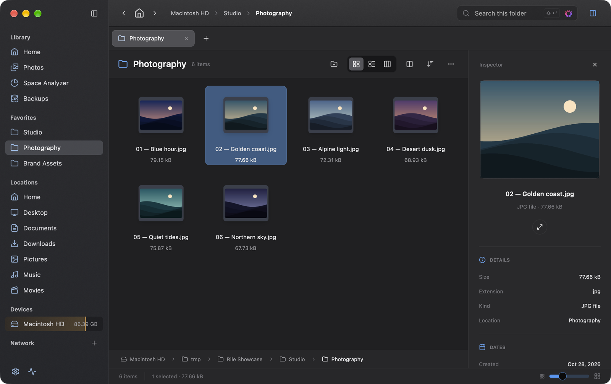
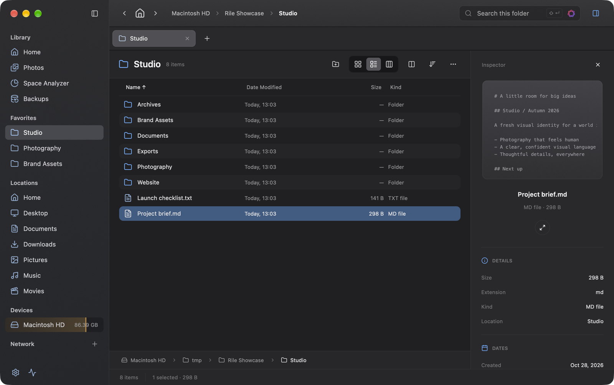
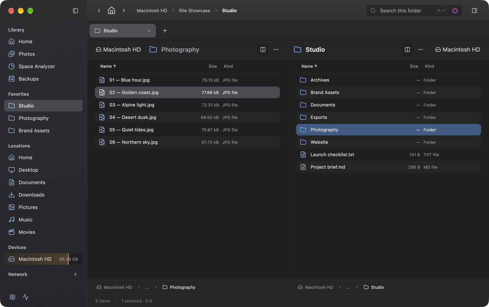
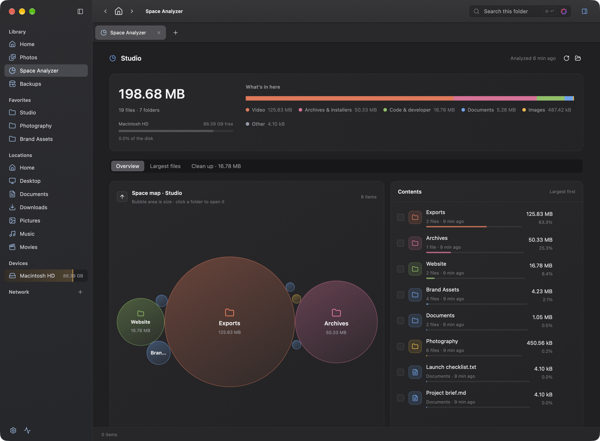
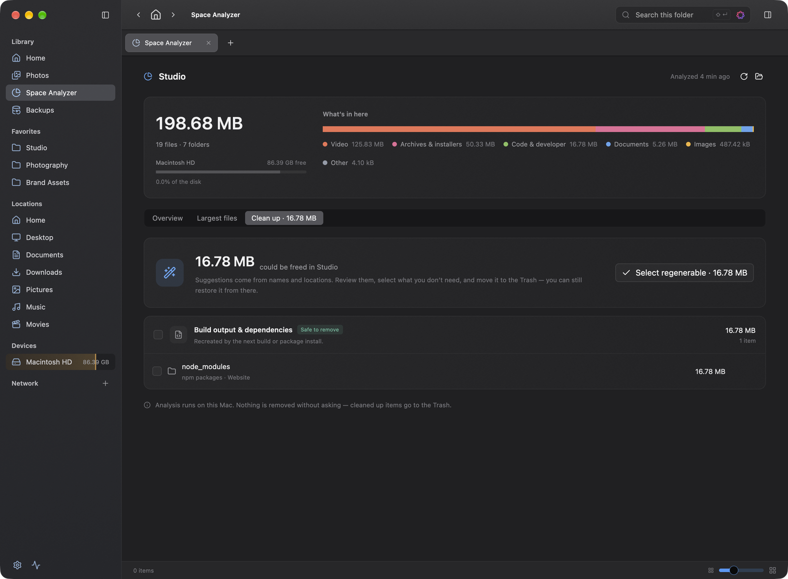
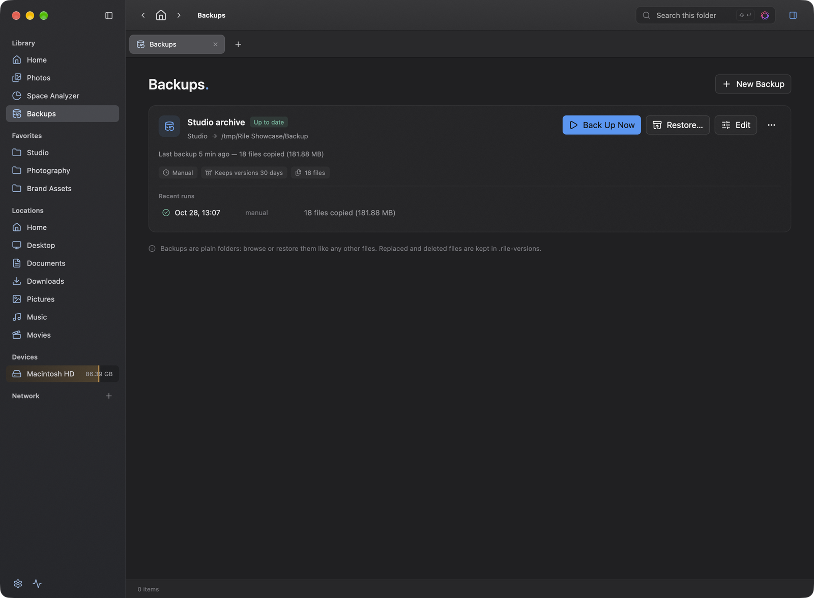
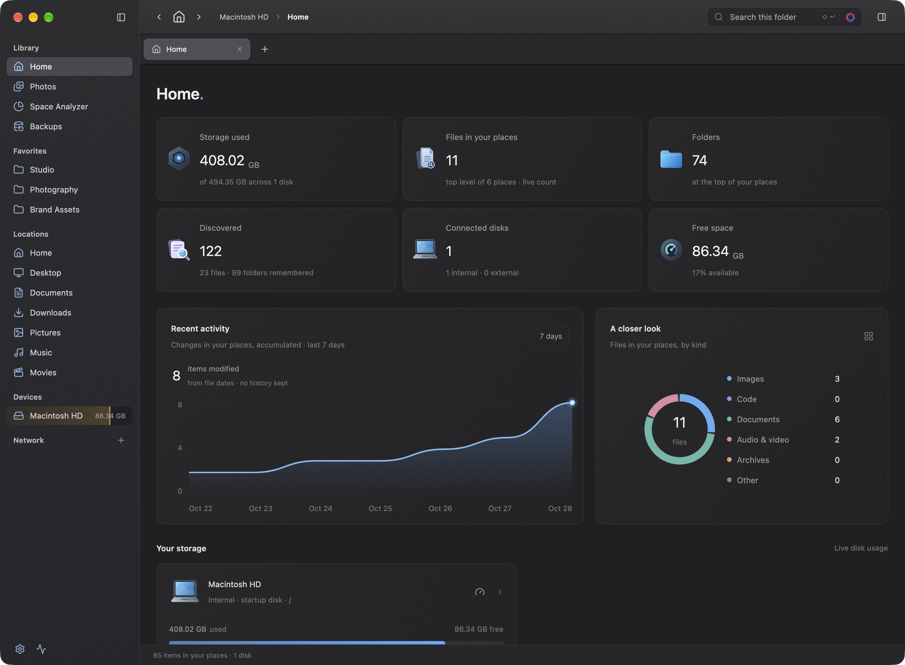
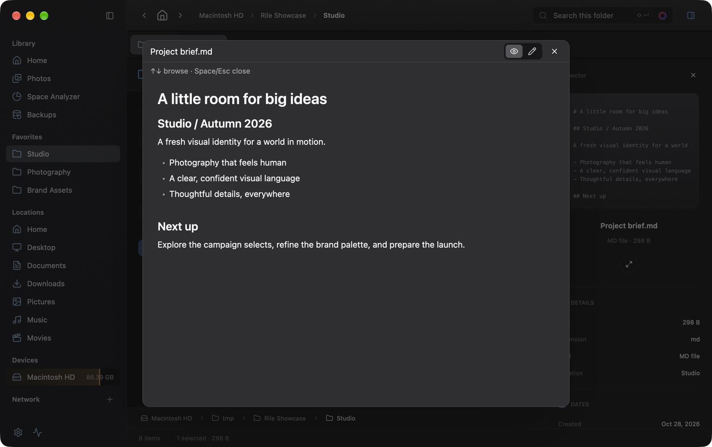
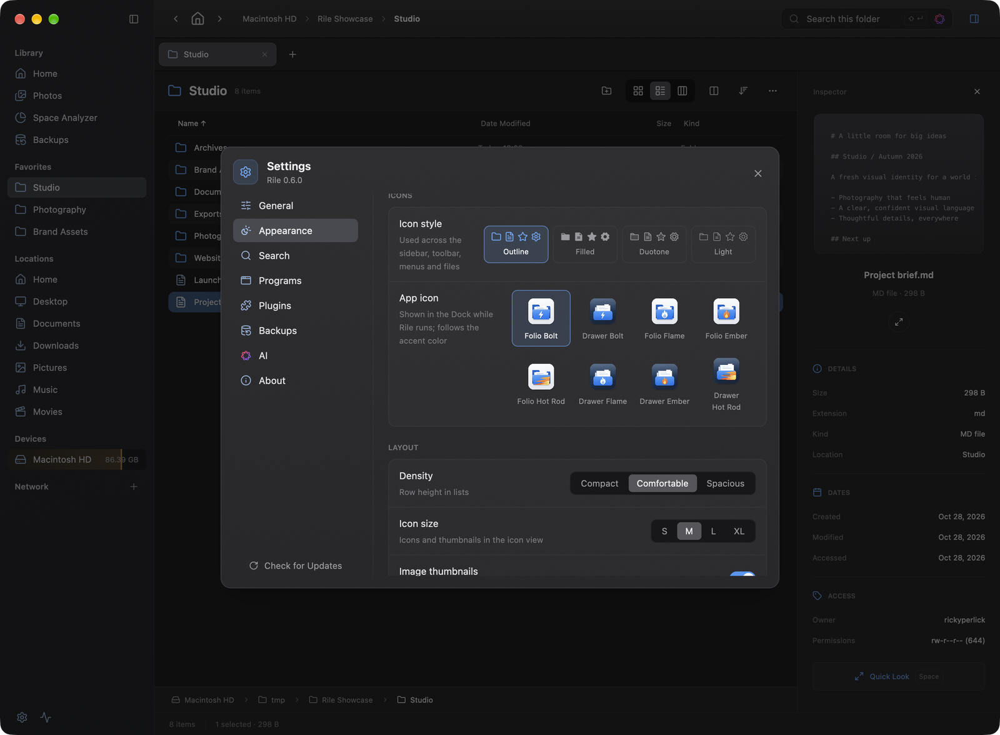

# Rile

**A fast file explorer built in Rust with [GPUI](https://gpui-kit.com).**

Browse local files and remote servers, preview what matters, and search your files. Rile brings tabs, multiple views, file operations, and on-device intelligence together in a native desktop interface.

[**Download for macOS and Windows**](https://github.com/RickyDane/rile/releases/latest) · [What's new in v0.7.0](CHANGELOG.md)

## See it in action

Real captures of the native macOS app, using an illustrative Studio workspace and generated sample artwork. Storage totals, devices, and other system information reflect the capture machine—not demo values painted over the UI. Click any image for a closer look.



### Find your flow

Browse with an inspector at your side, or put two folders next to each other.

| List view and inspector | Dual-pane browsing |
| :---: | :---: |
|  |  |

### Make room for what matters

See where storage goes, then review cleanup suggestions before moving anything to the Trash.

| Space Analyzer | Cleanup suggestions |
| :---: | :---: |
|  |  |

### Keep an eye on your files

Back up your work and check its run history. Get a live overview of storage and file activity from Home.

| Backups | Home |
| :---: | :---: |
|  |  |

### Look closer. Make it yours.

Read Markdown without leaving your folder, and choose the icons and layout that suit you.

| Quick Look | Appearance |
| :---: | :---: |
|  |  |

An interactive design prototype is also available in [`mockups/`](mockups/README.md); its sample data is illustrative and is not the native application.

## What you can do

- **Browse your way:** switch between list, thumbnail grid, and Miller-column views; open folder tabs or work in two panes. Navigate with breadcrumbs, history, favorites, and mounted devices.
- **Work with files:** copy, move, rename, duplicate, trash, or delete; drag and drop between folders, Finder, and remote servers. Transfers support progress, cancellation, and background execution.
- **Inspect and preview:** use Quick Look, the inspector, or Properties for files and recursive folder totals. Preview PDFs, images, and syntax-highlighted text.
- **Search on demand:** search recursively by name, glob, regex, content, size, date, and type, with `.gitignore` support and an optional Spotlight backend. A discovery index remembers visited folders for faster subsequent searches; it can be disabled or cleared in Settings.
- **Nearby Devices:** other computers running Rile on your network show up automatically. Pair once with a 6-digit code, then browse the folders they share (read-only) and send each other files, which the receiver accepts first. Everything travels directly over the local network with mutual TLS. Linux servers join with [Rile Server](#rile-server-linux), whose shares can also be read & write.
- **Connect to servers:** browse FTP, FTPS, SFTP, and SMB2/3 locations, transfer files, and manage remote entries. Choose nearby servers advertised over Bonjour/mDNS in the connection dialog, or enter a server manually. SMB connections show available disk shares; enter `smb://server/share` or set the start folder to `/share/folder` to connect directly. Credentials are stored in the Keychain.
- **Explore storage and photos:** the Overview shows live disk usage and recent file activity; Photos groups images from your home folder and Photos library by month.
- **Free up space:** the Space Analyzer measures a folder once, then lets you explore it as a bubble map, list its largest files, and review cleanup suggestions (caches, build output, installers, stale downloads) before moving them to the Trash.
- **Back up your work:** create incremental, versioned backups to local drives or saved server connections. Run them manually, on a schedule, or after changes; review history and restore files from the Backups page.
- **Use on-device AI:** on supported Apple systems, search by meaning, summarize files and folders, and describe or tag images and documents. Press **Shift+Enter** in search for AI search; **Enter** runs regular search.
- **Make it yours:** choose themes, accents, density, icon styles, and a startup folder. Extend context menus and previews with sandboxed [WebAssembly plugins](plugins/README.md).
- **Handle archives:** compress and extract ZIP, 7z, tar and supported compressed formats, with selectable compression levels.

## Getting started

To share a Linux server with Rile, see [Rile Server (Linux)](#rile-server-linux). It installs with one command.

### Run from source

Install a recent stable Rust toolchain (the workspace selects `stable` in [`rust-toolchain.toml`](rust-toolchain.toml)), then run:

```sh
cargo run -p rile-app
```

To start in a specific folder, pass its path after `--`. Passing a file reveals it instead:

```sh
cargo run -p rile-app -- ~/Documents
```

The default `ai` feature uses Apple Foundation Models on Apple Silicon with macOS 26 or later. To build without it:

```sh
cargo run -p rile-app --no-default-features
```

You can also use local GGUF models or download them from Hugging Face in **Settings → AI**.
Install the llama.cpp runtime directly from AI Settings or use your own executable; see [local model setup](docs/local-models.md).

### Build a macOS app

```sh
sh crates/rile-app/scripts/bundle_macos.sh
```

The bundle is written to `target/release/Rile.app`. Add `--debug` for `target/debug/Rile.app`. The release packaging script, [`scripts/bundle-macos.sh`](scripts/bundle-macos.sh), also supports signing, notarization, and DMG creation. Normal builds do not require the icon-generation tools; see [`gen_app_icon.sh`](crates/rile-app/scripts/gen_app_icon.sh) if you change the icon artwork.

### Build for Windows

On Windows 10 or 11 with the Rust MSVC toolchain and the Windows SDK (gpui compiles its shaders with `fxc.exe`):

```powershell
cargo run -p rile-app
pwsh scripts/bundle-windows.ps1   # dist/rile-x86_64-pc-windows-msvc.zip and the installer (needs Inno Setup 6)
```

The installer installs per user to `%LOCALAPPDATA%\Programs\Rile` without administrator rights. It adds **Open in Rile** to the context menu of folders and drives, and registers `rile://` links. Background backups run as a Task Scheduler task (`Rile\dev.rile.backup`), and the backup status helper sits in the notification area. Search through the OS index uses Windows Search; photo descriptions use the Windows text recognizer, and Apple Intelligence is not available. For AI features, choose a llama.cpp model in **Settings → AI**. From macOS you can type-check the Windows build with `cargo xwin check --workspace --target x86_64-pc-windows-msvc`.

### Use Rile as the default file manager

On Windows, choose **Make Rile Default** in **Settings → General → Windows Integration**. Folders opened from Explorer, shortcuts and other apps then open in Rile. **Restore Explorer** undoes it. Win+E and the desktop still use Explorer.

On macOS 12 or later, move `Rile.app` to Applications and launch that copy. In **Settings → General → macOS Integration**, choose **Make Rile Default** and approve macOS's confirmation if prompted. This changes folder opening and compatible **Reveal/Show in Finder** actions. Choose **Restore Finder** in the same section to revert; do this before uninstalling Rile.

Other applications may cache the previous viewer: restart them, or log out and back in, if necessary. Finder still manages the desktop, system Open/Save dialogs are unchanged, and applications that explicitly target Finder may continue to use it. Running the bare binary with `cargo run` does not provide the app-bundle registration required to become the default.

Some macOS versions reject folder associations, even when restoring Finder. In that case Rile still updates the separate file-viewer preference for compatible **Reveal/Show in Finder** actions and reports the partial change. Folder opening remains unchanged; this is not a full default-file-manager replacement. **Restore Finder** also restores the file-viewer preference in this situation. Cancelling a consent prompt does not apply this fallback.

## Rile Server (Linux)

Rile Server turns a Linux machine without a screen, such as a home server, NAS or Raspberry Pi, into a Nearby device. It runs in the background as a systemd service and appears under **Nearby** in Rile like any other computer. It shares the folders you choose: the whole machine, one folder or several, each read-only or read & write. Two programs are installed:

- `rile-server`: the background service.
- `rilectl`: the command-line tool to set up the server and change it later.

### Requirements

- A 64-bit Linux machine: x86_64, or aarch64 (for example a Raspberry Pi 4 or 5 with a 64-bit OS). The binaries are static, so any distribution works.
- systemd to run it in the background. Without systemd you can still start `rile-server run` yourself.
- Root access (`sudo`) for installing and for changes.
- The same local network as the Rile apps. Connections use TCP 47820, and discovery uses mDNS on UDP 5353.

### Install

Run this on the server:

```sh
curl -fsSL https://raw.githubusercontent.com/RickyDane/rile/master/packaging/linux/install.sh | sudo sh
```

The installer:

1. picks the right build for the CPU from the newest Rile release, prereleases included;
2. checks it against the release's `SHA256SUMS`;
3. installs `rile-server` and `rilectl` to `/usr/local/bin`;
4. starts the setup.

<details>
<summary>Installer options and manual install</summary>

Set these environment variables after `sudo` (for example `… | sudo RILE_VERSION=v0.8.0-beta.5 sh`):

| Variable | Effect |
| --- | --- |
| `RILE_VERSION=vX.Y.Z` | Install this release instead of the newest. |
| `RILE_TARBALL=/path/rile-server-….tar.gz` | Install from an archive you downloaded yourself. |
| `RILE_PREFIX=/opt/rile` | Install to `<prefix>/bin` instead of `/usr/local/bin`. The systemd service expects `/usr/local/bin`. |
| `RILE_NO_SETUP=1` | Only install the binaries; run `sudo rilectl setup` later. |

To install by hand, download `rile-server-x86_64-unknown-linux-musl.tar.gz` or `rile-server-aarch64-unknown-linux-musl.tar.gz` from the [releases](https://github.com/RickyDane/rile/releases). Then extract it, copy both binaries to `/usr/local/bin`, and run `sudo rilectl setup`. To build it yourself, run `cargo build --release -p rile-server`.
</details>

### Set it up

`sudo rilectl setup` asks a few questions. Use ↑ and ↓ to move, Space to tick, Tab to complete a path, Enter to confirm, and Esc to go back:

1. **Name shown in Rile.** The default is the host name.
2. **What should Rile apps see on this server?**
   - *The whole machine* shares `/`.
   - *One folder*: type its path (Tab completes) or leave the field empty to browse the folder tree.
   - *Several folders*: tick suggestions such as `/home/*`, `/srv/*`, `/mnt/*` and `/media/*/*`, then add more by path or by browsing.
3. **A name and access for each folder.**
   - *Read-only*: browse and download.
   - *Read & write*: also upload, rename and delete.
4. **Accept files sent with "Send to"?** If yes, they are saved in an inbox folder, `/srv/rile/inbox` by default. Only paired devices can send.
5. **Run the service as.**
   - *root* can read every file.
   - Your own account can only access what that account can.
6. The setup installs and starts the `rile-server` service, which then also starts with the system. If `ufw` or `firewalld` is active, it offers to open the ports.
7. Finally it offers to pair a Rile app right away.

### Pair a Rile app

1. On the server, run `sudo rilectl pair`. It waits 5 minutes; use `--timeout 15m` for longer.
2. In Rile, open **Nearby** in the sidebar. The server appears with a server icon. Click **Pair**.
3. Rile and the terminal show a 6-digit code. If both show the same code, type `y` in the terminal and click **Pair** in Rile.

Each device only needs to pair once. Afterwards the server's shared folders open like a drive from **Nearby**, and **Send to** delivers files to its inbox.

### Check that it runs

```sh
rilectl status                 # name, port, shares, inbox and paired devices (sudo if the service runs as root)
systemctl status rile-server   # service state
rilectl logs                   # follow the log (Ctrl-C to stop)
```

### Change it later

| Command | |
| --- | --- |
| `sudo rilectl share list` | Show the shared folders and their access. |
| `sudo rilectl share add [PATH] [--read-write \| --read-only] [--name N]` | Share another folder. Arguments you leave out are asked for. |
| `sudo rilectl share remove [NAME…]` | Stop sharing folders. Without names, you pick them from a list. |
| `sudo rilectl share edit [NAME]` | Rename a share or change its access. |
| `sudo rilectl share set-mode` | Choose again between the whole machine, one folder and several. |
| `sudo rilectl pair` / `devices` / `forget [ID]` | Pair a Rile app, list paired and nearby devices, unpair one. |
| `sudo rilectl name [NAME]` | Change the name shown in Rile. |
| `sudo rilectl inbox [PATH \| --off]` | Change the inbox, or decline files sent to the server. |
| `sudo rilectl port N` | Change the port (restarts the service). |
| `sudo rilectl reload` | Apply edits made to the config file by hand. |
| `sudo rilectl setup` | Run the whole setup again; your current answers are the defaults. |

Changes apply immediately, without a restart. The configuration is `/etc/rile-server/config.toml`, and the server's identity and pairings are in `/var/lib/rile-server`.

### Update and uninstall

- **Update:** run the install command again. It replaces the binaries, keeps the configuration and pairings, and restarts the service.
- **Uninstall:** run `sudo rilectl uninstall`. It removes the service and binaries and keeps the configuration. Add `--purge` to remove the configuration and pairings too.

### Troubleshooting

- **The server doesn't show up under Nearby.**
  - The Rile app and the server have to be on the same network and subnet; mDNS doesn't cross routers or most VPNs.
  - Check that UDP 5353 and TCP 47820 are open (`sudo ufw status`).
  - Check the log with `rilectl logs`.
- **"Didn't confirm the pairing."** No pairing window was open on the server, or the code was declined. Run `sudo rilectl pair` and pair again.
- **"Can't reach rile-server … permission denied".** Run `rilectl` with `sudo`.
- **Writes fail in a read & write share.** The service account needs write permission for the folder. Folders under `/usr`, `/boot` and `/etc` can only be changed when they are shared read & write. Run the setup again after changing this.
- **Try it without installing:** run `cargo run -p rile-server -- run --config /tmp/rs/config.toml --state /tmp/rs/state --socket /tmp/rs/ctl.sock`. Pass the same `--config` and `--socket` to `rilectl`.

## Keyboard shortcuts

| Shortcut | Action |
| --- | --- |
| `⌘T` / `⌘W` | Open / close a tab |
| `⌃Tab` | Switch tabs |
| `Tab` | Switch panes in dual-pane mode |
| `F5` / `F6` | Copy / move to the other pane |
| `Space` | Quick Look |
| `⌘I` | Properties |
| `⇧⌘P` | Toggle inspector |
| `⌘/` | Show all shortcuts |

## Configuration and plugins

On macOS, settings are stored in `~/Library/Application Support/rile/settings.toml`. On Windows they are in `%APPDATA%\rile\settings.toml`, and downloaded models and AI runtimes are in `%LOCALAPPDATA%\rile`. Set `RILE_CONFIG_DIR` to use another configuration directory. Plugins live in its `plugins/` folder; see the [plugin guide](plugins/README.md) for development and installation details.

## Development

```sh
cargo build --workspace --locked
cargo test --workspace --locked
```

| Crate | Responsibility |
| --- | --- |
| `rile-app` | GPUI application and interface |
| `rile-core` | File listing, operations, settings, history, and watching |
| `rile-backup` | Incremental backups, retained versions, restore, and background scheduling |
| `rile-services` | Search, previews, archives, properties, and system services |
| `rile-remote` | FTP/FTPS, SFTP, and SMB backends, Nearby Devices (Rile ↔ Rile), local-network discovery, and credentials |
| `rile-plugins` | Wasmtime component host and plugin interface |
| `rile-server` | Rile Server: headless Nearby daemon (`rile-server`) and its CLI (`rilectl`) for Linux |

The workspace declares the MIT license in [`Cargo.toml`](Cargo.toml).
